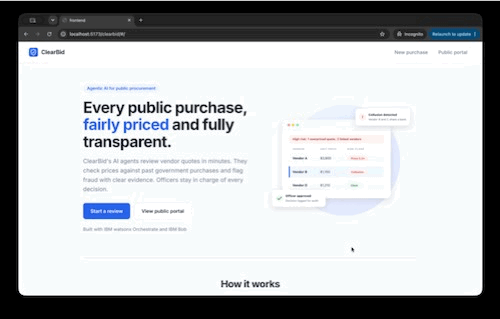

# ClearBid: Transparent Government Procurement 

Built for: IBM SkillsBuild AI Experiential Learning Lab

## Team: Void

## Track: 

Government & Public Services

## Project summary:

An AI agent system that reviews vendor quotes for public purchases. It compares prices with the market and with past government purchases, flags fraud and collusion, and publishes plain-language reports. AI flags and explains; the human officer decides.

## Demo

**[Click to view a Static Demo with seed data](https://buumu8.github.io/clearbid)**

## Final Presentation

## Target users:
Primary: Procurement officers at city, state and federal agencies
Secondary: Auditors and inspectors general
Public: Citizens and journalists

## Problem it solves
- Manual price research is slow and inconsistent
- Overpricing, bid rigging and shell companies waste public money
- Citizens can't easily see how or why money was spent

## Benefits
- Officers check whether prices are reasonable in minutes instead of hours
- Fraud is caught before the contract is awarded
- Every decision has a written record that holds up in an audit
- Public trust grows through open, readable reports

## Workflow

## Tools and Technology
- Frontend: ReactJS
- Backend: express, NodeJS
- Orchestration: IBM watsonx Orchestrate 
    - to orchestrate AI agent(s)
- IDE: IBM Bob
    - to synthesize mock data
    - to connect to IBM watsonx agent(s)
    - to finish up the frontend and backend

## UI/UX
### Landing Page

### New Purchase Request Page

### AI Agent Result Page

### Decision Page

### Public Report Page

